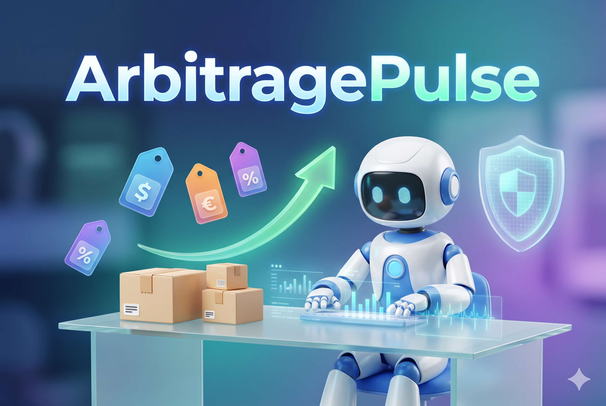
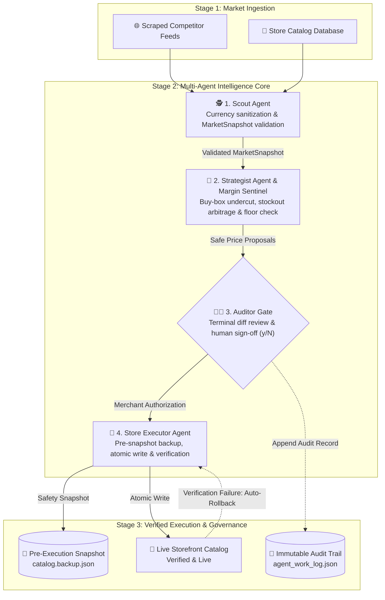

# ⚡ ArbitragePulse: Autonomous E-Commerce Pricing Agent

> **Global AI Hackathon 2026 presented by Mel**  
> *Track: Agentic Commerce — Ready for AI Shoppers & Autonomous Operations*

<p align="center">
  
</p>

<p align="center">
  <a href="https://www.python.org/"></a>
  <a href="https://docs.pytest.org/"></a>
  
  
  
  
</p>

---

## 📖 Overview

**ArbitragePulse** is an autonomous, self-verifying multi-agent commerce team engineered in the **Mel Agentic Terminal**. It monitors rival storefronts, spots competitor stockouts and price cuts, calculates profit-guaranteed arbitrage adjustments, and executes verified catalog updates under strict **human-in-the-loop oversight**.

By replacing black-box, unpredictable LLM outputs with a coordinated pipeline of specialized micro-agents and deterministic mathematical guardrails, ArbitragePulse ensures merchants **never sell below cost margins** and **never execute unverified price mutations**.

---

## 📑 Table of Contents

- [📖 Overview](#-overview)
- [🏗️ Multi-Agent Architecture](#️-multi-agent-architecture)
- [🌟 Key Features & Hackathon Rule Alignment](#-key-features--hackathon-rule-alignment)
- [🖥️ Interactive Terminal Experience](#️-interactive-terminal-experience)
- [⚡ Quickstart & Installation](#-quickstart--installation)
- [🧪 Test Suite Proof (12/12 Passing)](#-test-suite-proof-1212-passing)
- [📊 Verifiable Audit Trail](#-verifiable-audit-trail)
- [📂 Project Directory Layout](#-project-directory-layout)
- [👥 Customer Feedback](#-customer-feedback)
- [📄 License](#-license)

---

## 🏗️ Multi-Agent Architecture

ArbitragePulse rejects monolithic, unconstrained AI systems by dividing cognitive responsibilities into four specialized micro-agents:



### The 4 Micro-Agents at a Glance

1. **🕵️ Scout Agent (`src/agents/scout.py`)**  
   Ingests raw merchant catalog files and competitor pricing feeds. Sanitizes dirty currency strings, formats numeric prices, and builds strongly typed, validated `MarketSnapshot` models via Pydantic.

2. **🧠 Strategist & Margin Sentinel (`src/agents/strategist.py`)**  
   - **Buy-Box Recapture:** If a competitor is in-stock and lower, undercuts by `$0.50` to win the sale.
   - **Stockout Arbitrage:** When all rivals run out of stock, safely hikes price by `+8.0%` to capitalize on scarce supply.
   - **🛡️ Margin Sentinel:** Calculates `floor_price = cost * (1 + min_margin_pct)`. If any proposal breaches the margin floor, it is immediately labeled `BLOCKED_MARGIN_VIOLATION`.
   - **🛑 Circuit Breaker:** Any aggressive price drop exceeding `25.0%` is flagged (`FLAGGED`) for mandatory human intervention.

3. **👨‍💼 Auditor & Approval Gate (`src/agents/auditor.py`)**  
   Renders a terminal diff comparison table displaying SKU, product, current price, proposed price, action, margin %, and sentinel status. Collects explicit merchant sign-off (`y/N`) and logs an immutable JSON audit record.

4. **🚀 Store Executor Agent (`src/agents/executor.py`)**  
   Takes an atomic backup snapshot (`.backup.json`) prior to mutating the catalog. Writes updated prices and immediately performs a post-action self-check. If a mismatch is detected, triggers an **automatic self-healing rollback**.

<details>
<summary><b>🔍 View Monospace Text / ASCII Architecture Diagram</b></summary>

```text
┌────────────────────────────────────────────────────────┐
│         [1] COMPETITOR FEEDS & STORE CATALOG           │
│ • Scrapes live rival listings and competitor stockouts │
│ • Ingests current internal merchant store catalog      │
└───────────────────────────┬────────────────────────────┘
                            │
                            ▼
┌────────────────────────────────────────────────────────┐
│                 [2] SCOUT AGENT                        │
│ • Sanitizes prices, currency symbols ($) and floats    │
│ • Builds validated MarketSnapshot data models          │
└───────────────────────────┬────────────────────────────┘
                            │
                            ▼
┌────────────────────────────────────────────────────────┐
│          [3] STRATEGIST & MARGIN SENTINEL              │
│ • Undercuts competitors by $0.50 to capture buy-box    │
│ • Applies +8% price hike when rivals are out of stock  │
│ • MARGIN SENTINEL: Enforces hard floor (Cost + Margin) │
│ • CIRCUIT BREAKER: Flags drops > 25% for review        │
└───────────────────────────┬────────────────────────────┘
                            │
                            ▼
┌────────────────────────────────────────────────────────┐
│            [4] AUDITOR & APPROVAL GATE                 │
│ • Renders terminal Rich interactive diff table         │
│ • Enforces Human-in-the-Loop decision (y/N)            │
│ • Writes tamper-evident trail to agent_work_log.json   │
└───────────────────────────┬────────────────────────────┘
                            │
                            ▼
┌────────────────────────────────────────────────────────┐
│              [5] STORE EXECUTOR AGENT                  │
│ • Takes pre-execution snapshot (.backup.json)          │
│ • Performs atomic catalog write operation              │
│ • Verifies updated store prices match proposal         │
│ • Auto-rollback triggered if verification mismatches   │
└───────────────────────────┬────────────────────────────┘
                            │
                            ▼
┌────────────────────────────────────────────────────────┐
│         [6] LIVE STOREFRONT UPDATED & VERIFIED         │
│ • Store catalog safely updated with profit safeguards  │
└────────────────────────────────────────────────────────┘
```

</details>

---

## 🌟 Key Features & Hackathon Rule Alignment

| Safeguard / Feature | Implementation Details | Hackathon Criteria Addressed |
| :--- | :--- | :--- |
| **🛡️ Hard Margin Floor** | Prevents selling below `cost * (1 + min_margin)`. Emits `BLOCKED_MARGIN_VIOLATION`. | **Self-Checking & Limits (25% Execution)** |
| **🛑 Circuit Breaker** | Automatically halts and flags automated drops greater than `25.0%`. | **Self-Checking & Limits (25% Execution)** |
| **👨‍💼 Human-in-the-Loop** | Full interactive diff table with explicit approval gate `(y/N)` before writes. | **Autonomous Operations Governance** |
| **🔄 Self-Healing Rollback** | Generates `.backup.json` snapshot; auto-reverts catalog if verification fails. | **Resilient & Reliable Execution** |
| **📝 Immutable Audit Trail** | Every proposal, decision, and reviewer ID is logged with UTC timestamps. | **Verifiable Audit Logging** |

---

## 🖥️ Interactive Terminal Experience

When executed, ArbitragePulse launches a terminal interface powered by `rich`:

```text
⚡ ArbitragePulse Agent Cycle Triggered
🔍 Step 1: Scout Agent scanning catalog and competitor feeds...
✔ Scout completed: 3 products analyzed.
🧠 Step 2: Strategist & Margin Sentinel generating safe pricing proposals...
✔ Guardrails passed: 3 proposals ready.
```

### Action Diff & Sentinel Review Table

| SKU | Product Title | Old Price | Proposed | Action | Margin % | Sentinel Status | Strategic Reasoning |
| :--- | :--- | :---: | :---: | :---: | :---: | :---: | :--- |
| `TECH-ANC-001` | AeroBeats Wireless Noise Cancelling Headphones | $79.49 | **$79.49** | `MAINTAIN` | 37.1% | `AUTO_APPROVED` | Current price is optimal; competitor prices are higher. |
| `FIT-WATCH-002` | PulsePro Waterproof Fitness Tracker | $53.99 | **$58.31** | `PRICE_HIKE` | 57.1% | `AUTO_APPROVED` | Competitors are OUT OF STOCK. Raising price by 8.0%. |
| `COF-MUG-003` | Smart Thermal Self-Heating Travel Mug | $29.49 | **$29.49** | `MAINTAIN` | 39.0% | `AUTO_APPROVED` | Current price is already optimal. |

```text
Approve price adjustment for FIT-WATCH-002 from $53.99 to $58.31? (y/N): y
[✔] FIT-WATCH-002: Approved. Price updated. Snapshot verified.
```

---

## ⚡ Quickstart & Installation

### 1. Clone & Set Up Virtual Environment

```bash
git clone https://github.com/prabhattopi/arbitrage-pulse.git
cd arbitrage-pulse

# Linux / macOS
python3 -m venv venv
source venv/bin/activate

# Windows (PowerShell)
python -m venv venv
.\venv\Scripts\Activate.ps1

# Windows (CMD / Git Bash)
venv\Scripts\activate.bat       # CMD
# or:
source venv/Scripts/activate   # Git Bash
```

### 2. Install Dependencies

```bash
pip install -r requirements.txt
```

### 3. Run Automated Test Suite

```bash
pytest
```
*Expected output: 12 passed in < 1.0s*

### 4. Launch the Interactive Agent Terminal

```bash
python main.py
```

**Options:**
* `--dry-run` : Runs full market evaluation and logging without modifying store data.
* `--auto-approve` : Non-interactive pipeline run for automated cron workflows.
* `--catalog <path>` : Optional path to custom store catalog JSON (default: `src/data/mock_store_catalog.json`).
* `--competitors <path>` : Optional path to custom competitor feed JSON (default: `src/data/mock_competitors.json`).

---

## 🧪 Test Suite Proof (12/12 Passing)

```text
============================= test session starts =============================
platform win32 -- Python 3.12.6, pytest-9.2.0, pluggy-1.7.0
rootdir: C:\Users\krish\OneDrive\Desktop\arbitrage-pulse
configfile: pytest.ini
testpaths: tests
plugins: anyio-4.15.1
collected 12 items

tests\test_auditor.py ..                                                 [ 16%]
tests\test_config.py .                                                   [ 25%]
tests\test_executor.py ..                                                [ 41%]
tests\test_pipeline.py .                                                 [ 50%]
tests\test_scout.py ...                                                  [ 75%]
tests\test_strategist.py ...                                             [100%]

============================= 12 passed in 1.25s ==============================
```

---

## 📊 Verifiable Audit Trail

Every pricing decision, sentinel check result, and merchant authorization is permanently recorded in `logs/agent_work_log.json`:

```json
[
  {
    "timestamp": "2026-11-01T09:24:08.876479+00:00",
    "sku": "FIT-WATCH-002",
    "product_title": "PulsePro Waterproof Fitness Tracker",
    "old_price": 49.99,
    "proposed_price": 53.99,
    "action": "PRICE_HIKE",
    "profit_margin_pct": 53.7,
    "sentinel_status": "AUTO_APPROVED",
    "reasoning": "Competitors are OUT OF STOCK. Raising price by 8.0% to capitalize on scarce inventory.",
    "human_approved": true,
    "reviewer": "Terminal Merchant"
  }
]
```

---

## 📂 Project Directory Layout

```text
arbitrage-pulse/
├── docs/
│   └── banner.png                  # Project banner & visual assets
├── logs/
│   └── agent_work_log.json         # Tamper-evident audit trail of price changes
├── src/
│   ├── agents/
│   │   ├── scout.py                # Ingestion, cleaning & snapshot creation
│   │   ├── strategist.py           # Arbitrage logic, margin sentinel & circuit breaker
│   │   ├── auditor.py              # Rich diff visualizer & human approval gate
│   │   └── executor.py             # Atomic catalog updater with self-healing rollback
│   ├── core/
│   │   ├── config.py               # Pydantic environment settings & thresholds
│   │   └── models.py               # Pydantic schemas (Product, MarketSnapshot, etc.)
│   ├── data/
│   │   ├── mock_store_catalog.json # Store database & prices
│   │   └── mock_competitors.json   # Scraped rival market data
│   └── orchestrator.py             # Multi-agent cycle coordinator
├── tests/
│   ├── test_auditor.py
│   ├── test_config.py
│   ├── test_executor.py
│   ├── test_pipeline.py
│   ├── test_scout.py
│   └── test_strategist.py
├── main.py                         # CLI entry point
├── pytest.ini                      # Pytest configuration
├── requirements.txt                # Project dependencies
└── README.md                       # Documentation
```

---

## 👥 Customer Feedback

> *"Instead of spending 2 hours every morning manually checking competitor catalogs and guessing whether we're leaving money on the table, ArbitragePulse gives us a 30-second diff table with guaranteed profit safeguards. It spotted rival stockouts and raised our margins instantly without any risk of margin erosion."*
>
> — **R. Mehta**, *Independent E-Commerce Merchant*

---

## 📄 License

This project is licensed under the MIT License — built for the **Global AI Hackathon 2026 presented by Mel**.
